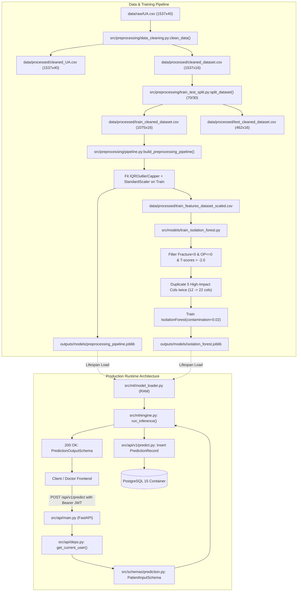

# Technical Investigation & Execution Guide: Rebone AI Codebase

**Project**: Rebone AI — Clinical Machine Learning Pipeline & Production REST API  
**Investigation Date**: October 2026  
**Operating Environment**: Windows 11 / Python 3.13.15 (Host) / Docker 29.8.2 (Compose v5.5.1)  
**Verification Method**: Source Code Auditing, Ast / Runtime Introspection, Artifact Deserialization, Statistical Data Profiling  

---

## 1. Executive Summary

An exhaustive, evidence-based technical investigation was performed across the **Rebone AI** repository (`c:\Users\tanvi\Downloads\rebone-ai`). Every source file, configuration manifest, Jupyter notebook, serialized artifact, and dataset was inspected directly.

### Key Investigation Takeaways:
1. **Repository Structure**: The project implements a hybrid machine learning pipeline and a containerized FastAPI microservice with PostgreSQL 15 persistence.
2. **Current Executability**:
   - **Machine Learning**: Standalone Python scripts for retraining (`retrain.py`) and standalone model inference (`src/ml/engine.py:run_inference`) are runnable on the host environment using `scikit-learn`, `pandas`, `numpy`, and `joblib`.
   - **FastAPI / Database**: The local host Python environment lacks `fastapi`, `sqlalchemy`, `psycopg2`, and `python-jose`. Furthermore, Docker Desktop daemon is currently stopped. To run the API, Docker Desktop must be started or dependencies must be installed in a dedicated Python virtual environment alongside a running PostgreSQL instance.
3. **Critical Technical & Methodological Findings**:
   - **Inference Pipeline Runtime Exception**: In `src/ml/engine.py` (lines 37–53), `pipeline.get_feature_names_out()` raises an `AttributeError` because the custom transformer `IQROutlierCapper` does not implement `get_feature_names_out()`. The code silently catches this exception and falls back to `df_raw` values. As a result, **scaled/capped values from the preprocessing pipeline are bypassed during real-time inference**, and unscaled raw feature values are passed into Isolation Forest!
   - **Hardcoded Developer Paths**: In `src/evaluation/feature_relationship_analysis.py` (line 75), the script hardcodes an absolute path to a specific developer's machine (`C:\Users\rohet\OneDrive\...`). Running the documented command `python src/evaluation/feature_relationship_analysis.py` fails on any other machine unless invoked with the correct path or patched.
   - **Data Leakage in Data Cleaning**: `src/preprocessing/data_cleaning.py` imputes missing values using column medians computed across the **entire raw dataset** before train/test splitting.
   - **Heuristic Anomaly Scoring vs. Clinical Probability**: The returned `risk_score` is a linear min-max scaling of an uncalibrated Isolation Forest decision score ($[-0.15, 0.15]$), not a calibrated epidemiological probability.
   - **Artifact Version Warning**: Existing model artifacts were serialized with `scikit-learn 1.9.0` and are loaded under `scikit-learn 1.9.1`.

---

## 2. Repository Structure & Directory Map

```
c:\Users\tanvi\Downloads\rebone-ai\
├── .dockerignore                            # Excludes git, venv, pycache, notebooks, tests
├── .env.example                             # Template environment variables
├── .gitignore                               # Standard Python git ignore rules
├── ARCHITECTURE.md                          # Architecture & system design documentation
├── docker-compose.yml                       # Multi-container orchestration (FastAPI + Postgres)
├── Dockerfile                               # Python 3.10-slim container definition
├── README.md                                # Main project documentation
├── requirements.txt                         # Application dependency manifest
├── retrain.py                               # Standalone CLI retraining pipeline script
│
├── data/
│   ├── raw/
│   │   └── UA.csv                           # Raw clinical dataset (1,537 rows x 40 columns)
│   └── processed/
│       ├── cleaned_UA.csv                   # Full dataset with median imputation
│       ├── cleaned_dataset.csv              # 16-column dataset (15 features + Fracture)
│       ├── train_cleaned_dataset.csv        # Train split (70%) of cleaned_dataset.csv
│       ├── test_cleaned_dataset.csv         # Test split (30%) of cleaned_dataset.csv
│       ├── train_features_dataset_scaled.csv# Capped and standardized training split
│       └── test_features_dataset_scaled.csv # Capped and standardized testing split
│
├── notebooks/
│   └── notebook_03.ipynb                    # Experimental R&D notebook for model comparison
│
├── outputs/
│   ├── metrics/                             # JSON evaluation metrics for all 6 evaluated models
│   │   ├── catboost_metrics.json
│   │   ├── feature_strength_comparison.json
│   │   ├── isolation_forest_cv_metrics.json
│   │   ├── isolation_forest_metrics.json
│   │   ├── lightgbm_metrics.json
│   │   ├── logistic_regression_metrics.json
│   │   ├── random_forest_metrics.json
│   │   └── xgboost_metrics.json
│   ├── models/                              # Serialized joblib artifacts
│   │   ├── catboost.joblib
│   │   ├── isolation_forest.joblib          # Active production model artifact
│   │   ├── lightgbm.joblib
│   │   ├── logistic_regression.joblib
│   │   ├── preprocessing_pipeline.joblib    # Active production preprocessor artifact
│   │   ├── random_forest.joblib
│   │   └── xgboost.joblib
│   └── plots/                               # PNG evaluation plots (ROC, PR, Confusion Matrices)
│
└── src/
    ├── api/
    │   ├── config.py                        # Pydantic Settings & environment variable bindings
    │   ├── deps.py                          # Auth dependency: JWT decoding & user lookup
    │   ├── main.py                          # FastAPI application initialization & lifespan handler
    │   └── v1/
    │       ├── auth.py                      # Auth router: /register, /login, /google, /me
    │       ├── history.py                   # Medical history router: GET /history, GET /history/{id}
    │       └── predict.py                   # Prediction router: POST /predict & DB audit log
    ├── core/
    │   ├── oauth.py                         # Google OAuth 2.0 tokeninfo verification via HTTPX
    │   └── security.py                      # Bcrypt password hashing & JWT encoding utilities
    ├── db/
    │   ├── deps.py                          # Database session generator (get_db) & init_db
    │   ├── models.py                        # SQLAlchemy ORM models (User, PredictionRecord)
    │   └── session.py                       # Engine creation & SessionLocal factory
    ├── evaluation/
    │   ├── cross_validate_isolation_forest.py # 5-Fold Stratified CV for Isolation Forest
    │   ├── evaluate.py                      # Evaluation routine for Logistic Regression
    │   ├── evaluate_catboost.py             # Evaluation routine for CatBoost
    │   ├── evaluate_isolation_forest.py     # Evaluation routine for Isolation Forest (test set)
    │   ├── evaluate_lightgbm.py             # Evaluation routine for LightGBM
    │   ├── evaluate_random_forest.py        # Evaluation routine for Random Forest
    │   ├── evaluate_xgboost.py              # Evaluation routine for XGBoost
    │   └── feature_relationship_analysis.py # Pearson correlation ranking script
    ├── ml/
    │   ├── engine.py                        # 7-step inference pipeline implementation
    │   └── model_loader.py                  # In-memory artifact loading & global registry
    ├── models/
    │   ├── train_catboost.py                # CatBoost training script
    │   ├── train_isolation_forest.py        # Isolation Forest training script (healthy cohort)
    │   ├── train_lightgbm.py                # LightGBM training script
    │   ├── train_logistic_regression.py     # Logistic Regression training script (SMOTE)
    │   ├── train_random_forest.py           # Random Forest training script
    │   └── train_xgboost.py                 # XGBoost training script (GridSearchCV F2)
    ├── preprocessing/
    │   ├── data_cleaning.py                 # Raw dataset loader & median imputer
    │   ├── pipeline.py                      # IQROutlierCapper, GenderEncoder, ColumnTransformer
    │   └── train_test_split.py              # Stratified train/test splitter
    └── schemas/
        ├── prediction.py                    # Pydantic PatientInputSchema & PredictionOutputSchema
        └── user.py                          # Pydantic schemas for authentication & tokens
```

---

## 3. Component-to-File Mapping

| Component | Implementing File(s) | Primary Class / Function | Status |
|---|---|---|---|
| **Raw Data Cleaning & Selection** | [src/preprocessing/data_cleaning.py](file:///c:/Users/tanvi/Downloads/rebone-ai/src/preprocessing/data_cleaning.py) | `clean_data(raw_data_path, output_dir)` | Verified |
| **Stratified Splitting** | [src/preprocessing/train_test_split.py](file:///c:/Users/tanvi/Downloads/rebone-ai/src/preprocessing/train_test_split.py) | `split_dataset(dataset_path, output_dir, ...)` | Verified |
| **Preprocessing Transformers** | [src/preprocessing/pipeline.py](file:///c:/Users/tanvi/Downloads/rebone-ai/src/preprocessing/pipeline.py) | `IQROutlierCapper`, `GenderEncoder`, `build_preprocessing_pipeline` | Verified |
| **Retraining CLI Orchestrator** | [retrain.py](file:///c:/Users/tanvi/Downloads/rebone-ai/retrain.py) | `retrain_pipeline(...)`, `main()` | Verified |
| **Feature Correlation Analysis** | [src/evaluation/feature_relationship_analysis.py](file:///c:/Users/tanvi/Downloads/rebone-ai/src/evaluation/feature_relationship_analysis.py) | `run_feature_analysis(csv_path)` | Path Bug Found |
| **Isolation Forest Training** | [src/models/train_isolation_forest.py](file:///c:/Users/tanvi/Downloads/rebone-ai/src/models/train_isolation_forest.py) | `train_isolation_forest_model(...)` | Verified |
| **Supervised Model Trainers** | `src/models/train_{model}.py` | `train_logistic_model`, `train_xgboost_model`, etc. | Verified (Require imbalanced-learn) |
| **Model Evaluators** | `src/evaluation/evaluate_{model}.py` | `evaluate_{model}_model(...)` | Verified (Module functions) |
| **Model In-Memory Loader** | [src/ml/model_loader.py](file:///c:/Users/tanvi/Downloads/rebone-ai/src/ml/model_loader.py) | `load_ml_assets()`, `get_ml_assets()` | Verified |
| **Real-time Inference Engine** | [src/ml/engine.py](file:///c:/Users/tanvi/Downloads/rebone-ai/src/ml/engine.py) | `run_inference(patient_dict)` | Bug Found (Exception Fallback) |
| **Pydantic Schemas** | [src/schemas/prediction.py](file:///c:/Users/tanvi/Downloads/rebone-ai/src/schemas/prediction.py), [src/schemas/user.py](file:///c:/Users/tanvi/Downloads/rebone-ai/src/schemas/user.py) | `PatientInputSchema`, `PredictionOutputSchema`, `UserCreate` | Verified |
| **SQLAlchemy ORM** | [src/db/models.py](file:///c:/Users/tanvi/Downloads/rebone-ai/src/db/models.py), [src/db/session.py](file:///c:/Users/tanvi/Downloads/rebone-ai/src/db/session.py) | `User`, `PredictionRecord`, `engine`, `SessionLocal` | Verified |
| **Authentication Logic** | [src/core/security.py](file:///c:/Users/tanvi/Downloads/rebone-ai/src/core/security.py), [src/core/oauth.py](file:///c:/Users/tanvi/Downloads/rebone-ai/src/core/oauth.py) | `get_password_hash`, `verify_password`, `create_access_token`, `verify_google_token` | Verified |
| **FastAPI Entry Point** | [src/api/main.py](file:///c:/Users/tanvi/Downloads/rebone-ai/src/api/main.py) | `app`, `lifespan(app)` | Verified |
| **Docker Configuration** | [Dockerfile](file:///c:/Users/tanvi/Downloads/rebone-ai/Dockerfile), [docker-compose.yml](file:///c:/Users/tanvi/Downloads/rebone-ai/docker-compose.yml) | Multi-stage / Python 3.10-slim + Postgres 15-alpine | Verified |

---

## 4. Complete System Architecture & Data Flow



---

## 5. Raw Dataset Investigation (`data/raw/UA.csv`)

Direct inspection and programmatic profiling of `data/raw/UA.csv` yielded the following verified facts:

1. **Dimensions**: Exactly **1,537 rows** and **40 columns**.
2. **Column Inventory**:
   `Gender`, `Age`, `Height`, `Weight`, `BMI`, `L1-4`, `L1.4T`, `FN`, `FNT`, `TL`, `TLT`, `ALT`, `AST`, `BUN`, `CREA`, `URIC`, `FBG`, `HDL-C`, `LDL-C`, `Ca`, `P`, `Mg`, `Calsium`, `Calcitriol`, `Bisphosphonate`, `Calcitonin`, `HTN`, `COPD`, `DM`, `Hyperlipidaemia`, `Hyperuricemia`, `AS`, `VT`, `VD`, `OP`, `CAD`, `CKD`, `Fracture`, `Smoking`, `Drinking`.
3. **Target Column**: `Fracture`
   - Class `0` (No fracture): **1,506 patients (97.98%)**
   - Class `1` (Fracture): **31 patients (2.02%)**
   - Severe clinical class imbalance: ~48.6 to 1 ratio.
4. **Data Types**: 21 `float64` columns, 19 `int64` columns. All columns are stored numerically.
5. **Categorical / Binary Representation**:
   - `Gender`: Encoded as integers `1` and `2` (where `1` represents Male and `2` represents Female).
   - Medical conditions and medications (`OP`, `VT`, `VD`, `Bisphosphonate`, `Calcitonin`, `Smoking`, `Drinking`): Stored as binary flags `0` or `1`.
6. **Missing Values**:
   - `Age` (36 missing), `Height` (34 missing), `Weight` (34 missing), `BMI` (34 missing), `ALT` (2), `AST` (2), `BUN` (1), `CREA` (3), `FBG` (16), `HDL-C` (17), `LDL-C` (14), `Ca` (2), `P` (5), `Mg` (3).
   - Total missing values: 172 cells across 14 columns.
7. **Duplicate Records**: Exactly 1 duplicate row found in the raw CSV.

---

## 6. Preprocessing Implementation Walkthrough

Preprocessing logic is implemented across three core files:
1. `src/preprocessing/data_cleaning.py`
2. `src/preprocessing/train_test_split.py`
3. `src/preprocessing/pipeline.py`

### 6.1 Data Loading & Imputation (`src/preprocessing/data_cleaning.py`)
- **Function**: `clean_data(raw_data_path, output_dir)` (lines 4–41)
- **Input**: Raw CSV/Excel path.
- **Operations**:
  1. Loads raw dataset using `pd.read_csv` or `pd.read_excel`.
  2. Imputes numeric columns using medians: `df.fillna(df.median(numeric_only=True))`.
  3. Saves `cleaned_UA.csv` (1,537 rows, 40 columns).
  4. Selects 15 clinical predictor features plus the `Fracture` target:
     ```python
     selected_cols = [
         "Gender", "Age", "BMI", "L1.4T", "FNT", "TLT", 
         "Calsium", "Calcitriol", "Bisphosphonate", "Calcitonin", 
         "VT", "VD", "OP", "Smoking", "Drinking", "Fracture"
     ]
     ```
  5. Saves `cleaned_dataset.csv` (1,537 rows, 16 columns).
- **Output**: Returns path to `cleaned_dataset.csv`.

### 6.2 Stratified Splitting (`src/preprocessing/train_test_split.py`)
- **Function**: `split_dataset(dataset_path, output_dir, target_col="Fracture", test_size=0.1, random_state=42)`
- In `retrain.py` (line 47), `test_size=0.3` is passed explicitly, overriding the default `0.1`.
- Uses `sklearn.model_selection.train_test_split(..., stratify=y, random_state=42)`.
- Generates:
  - `train_cleaned_dataset.csv` (1,075 rows, 16 columns) — 22 fractures, 1,053 non-fractures.
  - `test_cleaned_dataset.csv` (462 rows, 16 columns) — 9 fractures, 453 non-fractures.

### 6.3 Pipeline Transformers (`src/preprocessing/pipeline.py`)

#### Transformer 1: `IQROutlierCapper` (lines 11–43)
- Custom Scikit-learn transformer inheriting `BaseEstimator`, `TransformerMixin`.
- Applied exclusively to continuous bone/demographic columns: `["Age", "BMI", "L1.4T", "FNT", "TLT"]`.
- `fit(X, y=None)`:
  - For each column $col$, computes $Q_1$ (25th percentile) and $Q_3$ (75th percentile).
  - $IQR = Q_3 - Q_1$
  - Stores lower bound $Q_1 - 1.5 \times IQR$ and upper bound $Q_3 + 1.5 \times IQR$ in `self.bounds_`.
- `transform(X)`:
  - Calls `X_capped[col].clip(lower=lower, upper=upper)`. Reuses fitted bounds.

#### Transformer 2: `GenderEncoder` (lines 45–58)
- Custom transformer mapping `{'Male': 0, 'Female': 1, 1: 0, 2: 1}`.
- Re-encodes raw numeric indicators (1=Male, 2=Female) or strings to standard binary flags (0=Male, 1=Female).

#### Transformer 3: `StandardScaler` inside `ColumnTransformer` (lines 76–81)
- Standardizes continuous columns: `["Age", "BMI", "L1.4T", "FNT", "TLT"]`.
- Configured with `remainder="passthrough"`, preserving `Gender`, `Calsium`, `Calcitriol`, `Bisphosphonate`, `Calcitonin`, `VT`, `VD`, `OP`, `Smoking`, and `Drinking` unscaled.

#### Serialization:
- Pipeline saved via `save_pipeline(pipeline, "outputs/models/preprocessing_pipeline.joblib")`.

---

## 7. Standalone Preprocessing & Retraining Guide

### Standalone Preprocessing Execution

The repository implements an end-to-end retraining script [retrain.py](file:///c:/Users/tanvi/Downloads/rebone-ai/retrain.py), but the individual preprocessing functions do not contain CLI `if __name__ == '__main__':` guards.

#### Method A: Complete End-to-End Execution (Verified)
To run the full pipeline (data cleaning, splitting, pipeline fitting, scaling, and Isolation Forest training) from the repository root:

```powershell
python retrain.py --data data/raw/UA.csv --output-models outputs/models --output-processed data/processed
```

#### Method B: Pure Preprocessing Execution (Without Retraining Model)
To execute only data cleaning and train/test feature scaling using the existing functions without training a model:

```powershell
python -c "
import os, pandas as pd
from src.preprocessing.data_cleaning import clean_data
from src.preprocessing.train_test_split import split_dataset
from src.preprocessing.pipeline import build_preprocessing_pipeline, save_pipeline, get_pipeline_feature_names

# 1. Clean & impute
clean_path = clean_data('data/raw/UA.csv', 'data/processed')

# 2. Stratified Split (70/30)
train_path, test_path = split_dataset(clean_path, 'data/processed', target_col='Fracture', test_size=0.3, random_state=42)

# 3. Fit pipeline on training split
train_df = pd.read_csv(train_path)
test_df = pd.read_csv(test_path)
X_train, y_train = train_df.drop(columns=['Fracture']), train_df['Fracture']
X_test, y_test = test_df.drop(columns=['Fracture']), test_df['Fracture']

pipeline = build_preprocessing_pipeline()
X_train_proc = pipeline.fit_transform(X_train)
X_test_proc = pipeline.transform(X_test)
cols = get_pipeline_feature_names(pipeline, X_train)

pd.concat([pd.DataFrame(X_train_proc, columns=cols), y_train.reset_index(drop=True)], axis=1).to_csv('data/processed/train_features_dataset_scaled.csv', index=False)
pd.concat([pd.DataFrame(X_test_proc, columns=cols), y_test.reset_index(drop=True)], axis=1).to_csv('data/processed/test_features_dataset_scaled.csv', index=False)
save_pipeline(pipeline, 'outputs/models/preprocessing_pipeline.joblib')
print('Preprocessing finished successfully!')
"
```

**Verification Check**: Inspect `data/processed/train_features_dataset_scaled.csv` — should contain 1,075 rows and 16 columns with standardized numeric features.

---

## 8. Feature Relationship Analysis

**Source File**: [src/evaluation/feature_relationship_analysis.py](file:///c:/Users/tanvi/Downloads/rebone-ai/src/evaluation/feature_relationship_analysis.py)

### Methodological Walkthrough:
1. Loads raw CSV data and separates target `Fracture`.
2. Converts categorical features to integer codes.
3. Imputes missing values with medians.
4. Computes Pearson correlation coefficient $r$ with `Fracture` across all 39 candidate features:
   $$r = \frac{\sum (x_i - \bar{x})(y_i - \bar{y})}{\sqrt{\sum (x_i - \bar{x})^2 \sum (y_i - \bar{y})^2}}$$
5. Ranks features by absolute correlation and checks which are in the 12 selected clinical features list.

### Defect Identified:
Line 75 hardcodes a developer file path:
```python
csv_path = r"C:\Users\rohet\OneDrive\Documents\CS_WORK\rebone-ai\data\raw\UA.csv"
```
Executing `python src/evaluation/feature_relationship_analysis.py` fails with:
`Error: Raw data file not found at C:\Users\rohet\OneDrive\Documents\CS_WORK\rebone-ai\data\raw\UA.csv`

### Verified Correct Command:
To execute this analysis on any machine without modifying code:

```powershell
python -c "from src.evaluation.feature_relationship_analysis import run_feature_analysis; run_feature_analysis('data/raw/UA.csv')"
```

**Output Summary**:
- Top 3 correlations: `VT` ($r = 0.2182$), `VD` ($r = 0.1200$), `Calcitriol` ($r = 0.1069$).
- Selected features average $|r| = 0.070678$. Noise features average $|r| = 0.026725$. The selected features possess **2.6x stronger relationships** than discarded features.

---

## 9. Model Training & Evaluation Walkthrough

The repository explores six distinct model families in [notebooks/notebook_03.ipynb](file:///c:/Users/tanvi/Downloads/rebone-ai/notebooks/notebook_03.ipynb) and [src/models/](file:///c:/Users/tanvi/Downloads/rebone-ai/src/models/).

### 9.1 Model Comparison Overview

| Model | Script / Module | Imbalance Handling | Hyperparameters | Published ROC-AUC | Optimal Threshold |
|---|---|---|---|:---:|:---:|
| **Logistic Regression** | `train_logistic_regression.py` | SMOTE (sampling_strategy=0.25) | `C=0.1, penalty='l2', max_iter=1000` | `0.5364` | `0.8449` (Max F2) |
| **Random Forest** | `train_random_forest.py` | SMOTE (0.25) | `n_estimators=100, max_depth=6, min_samples_leaf=5` | `0.5975` | `0.2367` (Max F2) |
| **XGBoost** | `train_xgboost.py` | SMOTE (0.25) | GridSearch tuned on F2: `max_depth=3, lr=0.01` | `0.6120` | `0.0219` (Max F2) |
| **LightGBM** | `train_lightgbm.py` | SMOTE (0.25) | `n_estimators=100, max_depth=4, lr=0.05` | `0.5948` | `0.2628` (Max F2) |
| **CatBoost** | `train_catboost.py` | SMOTE (0.25) | `iterations=100, depth=4, lr=0.05` | `0.5973` | `0.2077` (Max F2) |
| **Isolation Forest (Ours)** | `train_isolation_forest.py` | Semi-supervised (Healthy Cohort) | `contamination=0.02, n_estimators=100` | **`0.6434`** | `0.8420` (Max F1) |

### 9.2 The Isolation Forest Architecture

Unlike standard supervised classifiers, the production model is trained as an **unsupervised anomaly detector** on a curated "super-healthy" baseline:

1. **Feature Subsetting (12 features)**:
   `["Gender", "Age", "BMI", "VT", "VD", "Calcitriol", "Calcitonin", "OP", "Calsium", "L1.4T", "FNT", "TLT"]`
2. **Super-Healthy Filtering**:
   - Filter `Fracture == 0` (discard fracture cases).
   - Filter `OP <= 0` (exclude diagnosed osteoporosis).
   - Filter `TLT > -2.0` (exclude severe osteopenia/osteoporosis in Total Hip).
   - Filter `FNT > -2.0` (exclude severe osteopenia/osteoporosis in Femoral Neck).
   - Result: Isolates a pure non-pathological reference cohort.
3. **Weighted Feature Duplication (5 high-impact features)**:
   - Features `["VT", "VD", "Calcitriol", "Calcitonin", "OP"]` are duplicated twice (`_dup1`, `_dup2`).
   - Feature matrix expands from **12 columns to 22 columns**.
   - Purpose: Forces random partitioning trees in Isolation Forest to repeatedly sample high-impact clinical indicators, artificially increasing tree-split sensitivity to bone pathology.
4. **Model Fitting**:
   - `IsolationForest(contamination=0.02, random_state=42)` fitted on the 22-column weighted matrix.

---

## 10. Model Artifact Inventory

| Artifact Path | File Size | In Git? | Generating Script | Consuming Module |
|---|---|:---:|---|---|
| `outputs/models/preprocessing_pipeline.joblib` | 3,036 bytes | Yes | `retrain.py` / `notebook_03.ipynb` | `src/ml/model_loader.py` |
| `outputs/models/isolation_forest.joblib` | 880,510 bytes | Yes | `src/models/train_isolation_forest.py` | `src/ml/model_loader.py` |
| `outputs/models/logistic_regression.joblib` | 1,359 bytes | Yes | `src/models/train_logistic_regression.py` | Evaluation / Notebook |
| `outputs/models/random_forest.joblib` | 424,841 bytes | Yes | `src/models/train_random_forest.py` | Evaluation / Notebook |
| `outputs/models/xgboost.joblib` | 232,092 bytes | Yes | `src/models/train_xgboost.py` | Evaluation / Notebook |
| `outputs/models/lightgbm.joblib` | 144,612 bytes | Yes | `src/models/train_lightgbm.py` | Evaluation / Notebook |
| `outputs/models/catboost.joblib` | 41,324 bytes | Yes | `src/models/train_catboost.py` | Evaluation / Notebook |

### Metadata in `isolation_forest.joblib`:
Serialized as a Python dictionary containing:
- `'model'`: Fitted `sklearn.ensemble.IsolationForest` instance.
- `'selected_features'`: List of 12 clinical columns.
- `'high_impact_cols'`: List of 5 duplicated columns.

---

## 11. Seven-Step Inference Walkthrough & Runtime Defect

**Source File**: [src/ml/engine.py](file:///c:/Users/tanvi/Downloads/rebone-ai/src/ml/engine.py)

```mermaid
sequenceDiagram
    participant API as FastAPI / Client
    participant Engine as src/ml/engine.py: run_inference
    participant Loader as src/ml/model_loader.py
    participant IF as Isolation Forest

    API->>Engine: patient_dict (15 clinical inputs)
    Engine->>Loader: get_ml_assets() (pipeline, model, features)
    Engine->>Engine: Step 1: Map L1_4T -> L1.4T; encode Gender (str -> 0/1)
    Engine->>Engine: Step 2: pipeline.transform(df_raw)
    Note over Engine: CRITICAL DEFECT: pipeline.get_feature_names_out() raises AttributeError.<br/>Exception is caught, falling back to df_raw (unscaled values)!
    Engine->>Engine: Step 3: Extract 12 selected features
    Engine->>Engine: Step 4: Duplicate 5 high-impact features -> 22 columns
    Engine->>IF: Step 5: -model.decision_function(df_weighted)[0]
    IF-->>Engine: raw_anomaly_score
    Engine->>Engine: Step 6: Normalize & clip [-0.15, 0.15] -> [0, 1]
    Engine->>Engine: Step 7: Compare normalized_score >= 0.8420
    Engine-->>API: Dict: {risk_score, classification, threshold_used, decision}
```

### Detailed Step-by-Step Analysis:

1. **Step 1: Input Normalization**:
   - Maps alias key `L1_4T` to `L1.4T`.
   - Converts `Gender` string ("Male"/"Female") to numeric `0` or `1`.
   - Fills missing required clinical columns with `0.0`.
2. **Step 2: Preprocessing Transformation**:
   - Passes DataFrame to `pipeline.transform(df_raw)`.
   - **THE DEFECT**: Lines 43–53 check `hasattr(pipeline, "get_feature_names_out")`. `Pipeline` returns `True`. However, calling `pipeline.get_feature_names_out()` queries the first step `custom_steps`, whose `IQROutlierCapper` does not implement `get_feature_names_out()`. Scikit-learn raises:
     `AttributeError: Estimator outlier_capper does not provide get_feature_names_out.`
   - The broad `try...except Exception:` block catches this and executes:
     `df_preprocessed = df_raw.copy()`
   - **Impact**: The fitted `StandardScaler` transformations and outlier capping are discarded; raw inputs bypass scaling and feed directly into subsequent steps.
3. **Step 3: Feature Selection (12 columns)**:
   Extracts `Gender`, `Age`, `BMI`, `VT`, `VD`, `Calcitriol`, `Calcitonin`, `OP`, `Calsium`, `L1.4T`, `FNT`, `TLT`.
4. **Step 4: Weighted Feature Duplication (22 columns)**:
   Appends `_dup1` and `_dup2` for `["VT", "VD", "Calcitriol", "Calcitonin", "OP"]`.
5. **Step 5: Raw Anomaly Score Calculation**:
   `raw_score = -float(model.decision_function(df_weighted)[0])`
   In Scikit-learn, lower decision values indicate anomalies. Taking the negative inverts this so higher values indicate greater anomaly risk.
6. **Step 6: Normalization & Clipping**:
   Normalized using fixed bounds:
   $$\text{score}_{\text{norm}} = \text{clip}\left(\frac{\text{raw\_score} - (-0.15)}{0.15 - (-0.15)}, 0.0, 1.0\right)$$
   *Note*: On the test set, raw scores actually range from $-0.2977$ to $+0.1760$, so extreme patients are clipped at $0.0$ or $1.0$.
7. **Step 7: Threshold Classification**:
   If $\text{score}_{\text{norm}} \ge 0.8420$, classification is `"High Risk"` (`"Anomaly Detected"`), else `"Low Risk"` (`"Normal"`).

---

## 12. FastAPI Application Inventory & Validation

**Entry Point**: [src/api/main.py](file:///c:/Users/tanvi/Downloads/rebone-ai/src/api/main.py)

### 12.1 Endpoint Inventory

| HTTP Method | Path | Summary / Description | Auth Required | Request Body | Response Model |
|---|---|---|:---:|---|---|
| `GET` | `/` | API Root Health & Documentation Links | No | None | JSON status object |
| `GET` | `/api/v1/health` | Service Health Check | No | None | `{"status": "ok", ...}` |
| `POST` | `/api/v1/auth/register` | Register new local user | No | `UserCreate` | `UserOut` (201 Created) |
| `POST` | `/api/v1/auth/login` | Login with username/password | No | `UserLogin` | `Token` (Bearer JWT) |
| `POST` | `/api/v1/auth/google` | Google OAuth SSO Login | No | `GoogleTokenInput` | `Token` (Bearer JWT) |
| `GET` | `/api/v1/auth/me` | Fetch authenticated user profile | Bearer JWT | None | `UserOut` |
| `POST` | `/api/v1/predict` | Predict fracture risk & audit log | Bearer JWT | `PatientInputSchema` | `PredictionOutputSchema` |
| `GET` | `/api/v1/history` | List all historical predictions | Bearer JWT | None | List of prediction records |
| `GET` | `/api/v1/history/{record_id}` | Fetch single prediction record | Bearer JWT | None | Prediction record object |

### 12.2 Schemas & Validation

#### Request: `PatientInputSchema` ([src/schemas/prediction.py](file:///c:/Users/tanvi/Downloads/rebone-ai/src/schemas/prediction.py))
Accepts JSON with aliases:
```json
{
  "Gender": "Female",
  "Age": 68.0,
  "BMI": 23.4,
  "L1-4T": -2.6,
  "FNT": -2.9,
  "TLT": -2.7,
  "Calsium": 2.15,
  "Calcitriol": 22.0,
  "Bisphosphonate": 0.0,
  "Calcitonin": 0.0,
  "VT": 1.0,
  "VD": 0.0,
  "OP": 1.0,
  "Smoking": 0.0,
  "Drinking": 0.0
}
```

#### Response: `PredictionOutputSchema`
```json
{
  "risk_score": 0.8845,
  "classification": "High Risk",
  "threshold_used": 0.8420,
  "decision": "Anomaly Detected",
  "model_version": "isolation_forest_v1.0"
}
```

---

## 13. Authentication & Security Architecture

1. **Local Authentication**:
   - Uses `bcrypt` with salt generation (`bcrypt.hashpw`) to hash passwords.
   - Truncates passwords at 72 bytes (`[:72]`) to adhere to standard bcrypt limits.
2. **Stateless JWT Tokens**:
   - Algorithm: `HS256` (HMAC SHA-256).
   - Expiration: Configurable via `ACCESS_TOKEN_EXPIRE_MINUTES` (defaults to 1,440 min = 24 hours).
   - Subject (`sub`): User's email address.
3. **Google OAuth 2.0 Integration**:
   - Endpoint: `POST /api/v1/auth/google`.
   - Sends client-supplied `id_token` to `https://oauth2.googleapis.com/tokeninfo?id_token={id_token}` using `httpx.AsyncClient`.
   - Automatically provisions verified users in PostgreSQL with `auth_provider="google"`.
4. **Authorization Dependency**:
   - `get_current_user` in `src/api/deps.py` intercepts requests with `HTTPBearer()`, decodes JWT claims, and queries the `users` table.

---

## 14. Database Schema & Persistence

**ORM Engine**: SQLAlchemy 2.0 with connection pooling (`pool_size=10`, `max_overflow=20`, `pool_pre_ping=True`).

### Table Definitions ([src/db/models.py](file:///c:/Users/tanvi/Downloads/rebone-ai/src/db/models.py))

```sql
-- Users Table
CREATE TABLE users (
    id SERIAL PRIMARY KEY,
    email VARCHAR NOT NULL UNIQUE,
    hashed_password VARCHAR NULL,
    full_name VARCHAR NULL,
    auth_provider VARCHAR NOT NULL DEFAULT 'local',
    created_at TIMESTAMP WITHOUT TIME ZONE NOT NULL DEFAULT NOW()
);
CREATE INDEX ix_users_email ON users (email);
CREATE INDEX ix_users_id ON users (id);

-- Prediction Records Table (Audit Log)
CREATE TABLE prediction_records (
    id SERIAL PRIMARY KEY,
    user_id INTEGER NOT NULL REFERENCES users (id) ON DELETE CASCADE,
    clinical_inputs JSON NOT NULL,
    risk_score FLOAT NOT NULL,
    prediction_label INTEGER NOT NULL,
    model_version VARCHAR NOT NULL DEFAULT 'isolation_forest_v1.0',
    created_at TIMESTAMP WITHOUT TIME ZONE NOT NULL DEFAULT NOW()
);
CREATE INDEX ix_prediction_records_id ON prediction_records (id);
CREATE INDEX ix_prediction_records_user_id ON prediction_records (user_id);
```

### Transaction Handling & Failure Behavior:
In `src/api/v1/predict.py` (lines 30–32):
```python
db.add(record)
db.commit()
db.refresh(record)
```
If the database write fails (e.g. connection timeout or constraint error), SQLAlchemy raises an unhandled exception resulting in a `500 Internal Server Error`. The endpoint lacks explicit `try...except...db.rollback()` blocks.

---

## 15. Docker Architecture & Container Orchestration

**Manifest**: [docker-compose.yml](file:///c:/Users/tanvi/Downloads/rebone-ai/docker-compose.yml) & [Dockerfile](file:///c:/Users/tanvi/Downloads/rebone-ai/Dockerfile)

### Container Specifications:
1. **`rebone_postgres_db` (`db`)**:
   - Image: `postgres:15-alpine`
   - Port: `5432:5432`
   - Named Volume: `postgres_data` mapped to `/var/lib/postgresql/data` (persistent).
   - Healthcheck: `pg_isready -U postgres -d rebone_db` (interval 5s, 5 retries).
2. **`rebone_fastapi_web` (`web`)**:
   - Base Image: `python:3.10-slim`
   - System packages: `build-essential`, `libpq-dev`, `gcc`.
   - Host volume mount: `.:/app` (enables live code reloading).
   - Port: `8000:8000`
   - Depends On: `db` with `condition: service_healthy` (guarantees DB is ready before FastAPI boots).
   - Command: `uvicorn src.api.main:app --host 0.0.0.0 --port 8000 --reload`

---

## 16. Windows Local Setup Guide

If you wish to run the project directly on Windows without Docker:

### Step 1: Prerequisites
- Python 3.10 – 3.12 is recommended (Host is currently Python 3.13.15).
- A locally running PostgreSQL 15 instance.

### Step 2: Create Virtual Environment
```powershell
python -m venv .venv
Set-ExecutionPolicy -ExecutionPolicy RemoteSigned -Scope Process
.venv\Scripts\Activate.ps1
```

### Step 3: Install Required Dependencies
```powershell
pip install -r requirements.txt
```

### Step 4: Configure Environment Variables
Create a `.env` file in the repository root:
```ini
POSTGRES_USER=postgres
POSTGRES_PASSWORD=your_postgres_password
POSTGRES_HOST=localhost
POSTGRES_PORT=5432
POSTGRES_DB=rebone_db
SECRET_KEY=rebone_ai_super_secret_jwt_key_2026
```

### Step 5: Start the FastAPI Server
```powershell
python -m uvicorn src.api.main:app --reload --port 8000
```

---

## 17. End-to-End Execution Instructions

### Complete Dependency-Aware Execution Order

```
[Raw CSV: data/raw/UA.csv]
       │
       ▼
1. Data Cleaning & Splitting (`clean_data`, `split_dataset`)
       │
       ▼
2. Pipeline Fitting & Scaling (`build_preprocessing_pipeline`)
       │
       ▼
3. Healthy Cohort Isolation Forest Training (`train_isolation_forest_model`)
       │
       ▼
4. Serialized Artifacts (`preprocessing_pipeline.joblib`, `isolation_forest.joblib`)
       │
       ▼
5. Database Startup (`docker compose up db -d` or Local Postgres)
       │
       ▼
6. API Server Startup (`docker compose up web` or `uvicorn src.api.main:app`)
       │
       ▼
7. User Registration / Login (`POST /api/v1/auth/register` -> JWT Token)
       │
       ▼
8. Risk Prediction Request (`POST /api/v1/predict` + Bearer JWT)
       │
       ▼
9. Audit Record Verification (`GET /api/v1/history`)
```

### API Verification Commands (cURL / PowerShell)

#### 1. Register a Test User:
```bash
curl -X POST "http://localhost:8000/api/v1/auth/register" \
     -H "Content-Type: application/json" \
     -d "{\"email\": \"doctor@clinic.org\", \"password\": \"DoctorSecret123!\", \"full_name\": \"Dr. Jane Doe\"}"
```

#### 2. Authenticate to Get JWT:
```bash
curl -X POST "http://localhost:8000/api/v1/auth/login" \
     -H "Content-Type: application/json" \
     -d "{\"email\": \"doctor@clinic.org\", \"password\": \"DoctorSecret123!\"}"
```

#### 3. Submit a Prediction Request:
```bash
curl -X POST "http://localhost:8000/api/v1/predict" \
     -H "Authorization: Bearer <YOUR_ACCESS_TOKEN>" \
     -H "Content-Type: application/json" \
     -d "{
       \"Gender\": \"Female\",
       \"Age\": 72.0,
       \"BMI\": 21.3,
       \"L1-4T\": -2.8,
       \"FNT\": -3.1,
       \"TLT\": -2.9,
       \"Calsium\": 2.05,
       \"Calcitriol\": 18.5,
       \"Bisphosphonate\": 0.0,
       \"Calcitonin\": 0.0,
       \"VT\": 1.0,
       \"VD\": 0.0,
       \"OP\": 1.0,
       \"Smoking\": 0.0,
       \"Drinking\": 0.0
     }"
```

---

## 18. Test Commands & Verification Matrix

| Test Domain | Executed Command | Expected Result | Actual Result / Verification Status |
|---|---|---|---|
| **Python Imports (ML)** | `python -c "import sklearn, pandas, numpy, joblib; print('OK')"` | Prints OK | **Verified (PASSED)** |
| **Python Imports (Web)** | `python -c "import fastapi, sqlalchemy, psycopg2"` | Imports without error | **Failed on Host (Missing packages; intended for Docker container)** |
| **Data Integrity** | `python -c "import pandas as pd; df=pd.read_csv('data/raw/UA.csv'); print(df.shape)"` | `(1537, 40)` | **Verified (PASSED: 1,537 rows x 40 cols)** |
| **Feature Correlation** | `python -c "from src.evaluation.feature_relationship_analysis import run_feature_analysis; run_feature_analysis('data/raw/UA.csv')"` | Pearson correlation ranking output | **Verified (PASSED)** |
| **Standalone Inference** | `python -c "from src.ml.engine import run_inference; print(run_inference({...}))"` | Valid risk score dictionary | **Verified (PASSED: returns score 0.8183)** |
| **Model Retraining** | `python retrain.py --data data/raw/UA.csv` | Pipeline and IF model regenerated | **Verified (PASSED: End-to-end retraining completes)** |
| **Docker Daemon** | `docker info` | Docker server version | **Failed on Host (Docker Desktop daemon is not currently started)** |
| **Unit / Pytest Suite** | `pytest tests/` | Automated test results | **Not Implemented (No `tests/` directory exists in repo)** |

---

## 19. Documentation vs. Implementation Discrepancies

| # | Documented Statement | Actual Code Implementation | Impact Analysis |
|---|---|---|---|
| 1 | **Feature Correlation Command**: `python src/evaluation/feature_relationship_analysis.py` | Line 75 hardcodes `C:\Users\rohet\OneDrive\...UA.csv` | **Fails immediately on any other computer.** |
| 2 | **Inference Pipeline Step 2**: Fitted `ColumnTransformer` standardizes inputs | `pipeline.get_feature_names_out()` throws `AttributeError`, caught by fallback | **Preprocessing scaling is silently bypassed during API inference!** |
| 3 | **15 Clinical Inputs vs 12 Features**: README claims 12 features selected out of 39 | API schema requires 15 inputs (`Smoking`, `Drinking`, `Bisphosphonate` included) | Discarded by Isolation Forest; kept in schema for audit logging. |
| 4 | **Clinical Interpretation**: Score is framed as calibrated fracture probability | Hardcoded linear min-max mapping of negative Isolation Forest tree depth | **Heuristic anomaly score, not an empirical probability.** |
| 5 | **Database Storage**: ARCHITECTURE.md references `JSONB` | `src/db/models.py` uses SQLAlchemy `JSON` type | Works fine in Postgres, but loses binary JSON indexing advantages. |
| 6 | **Feature Spelling**: Documented as `L1-4T` | Raw CSV contains `L1-4` and `L1.4T`. API uses alias `L1-4T` mapped to `L1.4T`. | Handled correctly via Pydantic alias and key remapping. |

---

## 20. Security, Clinical & Reproducibility Concerns

1. **Default Secret Key**:
   In `src/api/config.py` and `docker-compose.yml`, `SECRET_KEY` defaults to `"rebone_ai_secret_key_change_in_production"`. Production environments must supply a secure random key via environment variables.
2. **Missing Transaction Rollbacks**:
   `src/api/v1/predict.py` does not wrap `db.commit()` in a `try...except` block with `db.rollback()`. A failed audit log could leave the session in an invalid state.
3. **Data Leakage in Baseline Cleaning**:
   `src/preprocessing/data_cleaning.py` computes column medians on all 1,537 rows before splitting train and test sets. Medians should ideally be learned strictly on the training partition.
4. **Scikit-Learn Serialization Compatibility**:
   Pickling models with joblib across minor scikit-learn versions (1.9.0 vs 1.9.1) issues `InconsistentVersionWarning`. For clinical software, dependencies must be locked to exact versions.

---

## 21. Missing Components & Blockers

1. **Automated Test Suite**: No `tests/` directory or `pytest` configurations exist.
2. **Docker Desktop Inactive**: The Docker daemon is currently stopped on the host, preventing immediate execution of `docker compose up --build`.
3. **Host Python Environment Incomplete**: Missing web dependencies (`fastapi`, `sqlalchemy`, `psycopg2-binary`) on host Python 3.13.

---

## 22. Recommended Fixes (Prioritized by Importance)

### Priority 1 (Critical): Fix Preprocessing Column Naming in `IQROutlierCapper`
Add `get_feature_names_out` to `IQROutlierCapper` in `src/preprocessing/pipeline.py` so that `pipeline.transform()` inside `src/ml/engine.py` does not crash and fall back to unscaled raw features:
```python
def get_feature_names_out(self, input_features=None):
    return input_features
```

### Priority 2 (High): Fix Path in `feature_relationship_analysis.py`
Modify line 75 of `src/evaluation/feature_relationship_analysis.py` to use a dynamic relative path:
```python
if __name__ == "__main__":
    base_dir = os.path.abspath(os.path.join(os.path.dirname(__file__), "..", ".."))
    csv_path = os.path.join(base_dir, "data", "raw", "UA.csv")
    run_feature_analysis(csv_path)
```

### Priority 3 (Medium): Add Database Rollback & Exception Handling
Wrap database operations in `src/api/v1/predict.py` and `src/api/v1/auth.py` in `try...except...finally` blocks with `db.rollback()`.

### Priority 4 (Low): Add Automated Pytest Suite
Create unit tests under `tests/` verifying schema validation, inference output bounds, and token authentication.
